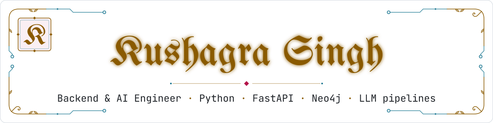
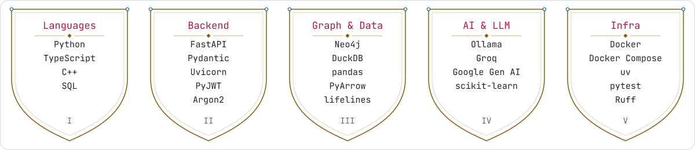

  <picture>
    <source media="(prefers-color-scheme: dark)" srcset="https://raw.githubusercontent.com/Kush-Core/Kush-Core/main/assets/frontispiece-dark.svg">
    
  </picture>

### ✠ The Proclamation · About
- B.Tech CSE, MIT Bengaluru ('27) · seeking software engineering internships
- I build async Python services (FastAPI), graph-backed data (Neo4j) and LLM extraction pipelines
- A devotee of the medieval — scriptoria, heraldry, candlelight — writing today's code with the same patience

### ✠ The Armory · Tech Stack
<picture>
  <source media="(prefers-color-scheme: dark)" srcset="https://raw.githubusercontent.com/Kush-Core/Kush-Core/main/assets/armory-dark.svg">
  
</picture>

Python · TypeScript · C++ · SQL · FastAPI · Pydantic · Uvicorn · PyJWT · Argon2 · Neo4j · DuckDB · pandas · PyArrow · lifelines · Ollama · Groq · Google Gen AI · scikit-learn · Docker · Docker Compose · uv · pytest · Ruff

### ✠ Deeds of Note · Projects
| Deed | What it does | Stack |
|---|---|---|
| [Narrative Mind](https://github.com/Kush-Core/Narrative_mind) · *The Web of Tales* | Async service that stores fictional worlds as a Neo4j graph, with LLM entity extraction and Graph RAG question answering, plus a React workspace | FastAPI · Neo4j · Ollama / Groq · React + TypeScript |
| [Hubahu](https://github.com/Kush-Core/hubahu) · *The Listening Scribe* | Checks Hindi audio episodes against their scripts and flags only the mismatches, with timestamps and clips (in progress) | Planned: FastAPI · Postgres · ONNX Runtime |
| [Renewal Risk](https://github.com/Kush-Core/Renewal-risk) · *The Ledger of Fortunes* | Scores churn risk per renewal decision from a 23M-row subscription payment log: calibrated models, six-cycle survival curves and plain-English reason codes | Python · DuckDB · scikit-learn · lifelines |
| [Throttling1](https://github.com/Kush-Core/Throttling1) · *The Clockwork Trial* | Microbenchmark measuring how compiler flags, OS scheduler contention and thread count change the runtime of a 100M-float sum on Apple M1 | C++ · clang · shell |

### ✠ The Chronicle · Recent Activity
<picture>
  <source media="(prefers-color-scheme: dark)" srcset="https://raw.githubusercontent.com/Kush-Core/Kush-Core/main/dist/chronicle-dark.svg">
  
</picture>

### ✠ The Tapestry · Contributions
<picture>
  <source media="(prefers-color-scheme: dark)" srcset="https://raw.githubusercontent.com/Kush-Core/Kush-Core/main/dist/tapestry-dark.svg">
  
</picture>

### ✠ Correspondence · Contact
<a href="https://www.linkedin.com/in/kushagra-singh-118b73329"><picture><source media="(prefers-color-scheme: dark)" srcset="https://raw.githubusercontent.com/Kush-Core/Kush-Core/main/assets/seal-linkedin-dark.svg"></picture></a>
<a href="mailto:kushagra10010@gmail.com"><picture><source media="(prefers-color-scheme: dark)" srcset="https://raw.githubusercontent.com/Kush-Core/Kush-Core/main/assets/seal-email-dark.svg"></picture></a>

Colophon — set in UnifrakturMaguntia & JetBrains Mono; re-illuminated daily by a Python Action.
